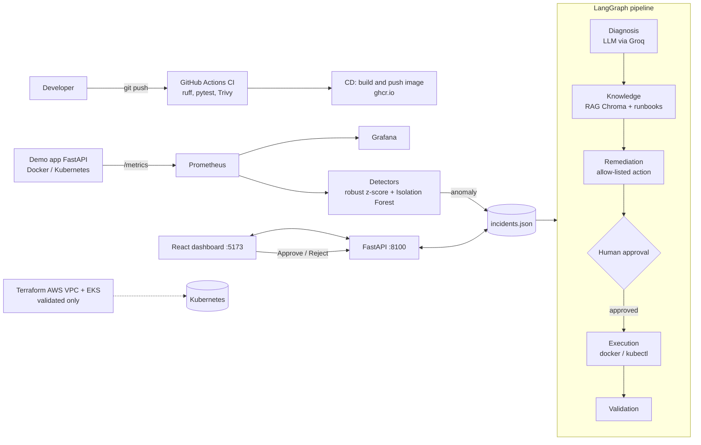

# AI-Powered AIOps Platform

An AIOps platform that **detects incidents** in a containerized application, **diagnoses** them with an LLM + RAG, **proposes a fix**, and executes it **only after human approval**, then validates the recovery.

Built as a personal learning project: FastAPI, Docker, Kubernetes, Prometheus/Grafana, GitHub Actions, Terraform, LangGraph, Chroma, React.

> **Honest status:** Terraform is **validated but never applied** (no AWS account used). The AI diagnosis can hallucinate, which is why every action needs human approval.

## Architecture



## Repository layout

| Path | Content |
|---|---|
| `demo-app/` | FastAPI test app (`/health`, `/metrics`, `/chaos/*` to inject faults) |
| `aiops-engine/` | Detectors, RAG, LangGraph agents, API |
| `aiops-engine/runbooks/` | Markdown runbooks indexed by the RAG |
| `dashboard/` | React + TypeScript dashboard |
| `k8s/` | Namespace, Deployments, Services, ConfigMap, HPA, Prometheus |
| `monitoring/` | Prometheus config for Docker Compose |
| `terraform/` | AWS VPC + EKS (validated, never applied) |
| `.github/workflows/` | CI (lint, tests, Trivy) and CD (image to ghcr.io) |

## Quick start (Docker Compose)

Requirements: Docker Desktop, Python 3.13, Node.js, a [Groq](https://console.groq.com) API key.

```powershell
docker compose up -d
```

| Service | URL |
|---|---|
| Demo app | http://127.0.0.1:8000 |
| Prometheus | http://127.0.0.1:9090 |
| Grafana | http://127.0.0.1:3030 (admin / admin, local only) |

Create `aiops-engine/.env` (never committed):

```
GROQ_API_KEY=your_key_here
GROQ_MODEL=openai/gpt-oss-120b
```

Run the engine:

```powershell
cd aiops-engine
pip install -r requirements.txt
python monitor.py
```

API and dashboard (separate terminals):

```powershell
cd aiops-engine
uvicorn api:app --host 127.0.0.1 --port 8100

cd dashboard
npm install
npm run dev
```

Inject a fault: open `http://127.0.0.1:8000/chaos/error500` repeatedly (or loop it in PowerShell).

## Kubernetes mode (Docker Desktop)

```powershell
docker build -t demo-app:local ./demo-app
kubectl apply -f k8s/namespace.yml
kubectl create secret generic db-secret -n aiops --from-literal=POSTGRES_PASSWORD=aiops
kubectl apply -f k8s/
```

The Secret is created by command and is **not** stored in Git. The password above is for local learning only.

Port-forwards (one terminal each):

```powershell
kubectl port-forward -n aiops svc/prometheus 9091:9090
kubectl port-forward -n aiops svc/backend 8001:8000
```

Then, in the monitor terminal:

```powershell
$env:PROMETHEUS_URL = "http://127.0.0.1:9091"
$env:AIOPS_CIBLE = "k8s"
python monitor.py
```

| Variable | Meaning | Default |
|---|---|---|
| `PROMETHEUS_URL` | Prometheus address | `http://127.0.0.1:9090` |
| `AIOPS_CIBLE` | `docker` or `k8s` (where context is collected and actions run) | `docker` |

| Port | Use |
|---|---|
| 8000 / 8001 | Demo app (Compose / port-forward) |
| 9090 / 9091 | Prometheus (Compose / port-forward) |
| 3030 | Grafana |
| 8100 | AIOps API |
| 5173 | Dashboard |

## Safety design

- **Allow-list of actions:** the LLM picks an action *name*, never a command. Docker: `redemarrer_backend`, `aucune`. Kubernetes: `redemarrer_backend_k8s`, `augmenter_replicas_k8s`, `annuler_deploiement_k8s`, `aucune`.
- **Human approval required** for every action; no answer within 5 minutes means refused.
- The API executes **no command**, listens on `127.0.0.1` only, and CORS is limited to the local dashboard. Never expose it publicly.
- Secrets (`.env`, `chroma_db/`, `approbations.*`) are git-ignored.

## CI/CD

- **CI:** ruff lint, pytest, Docker build, Trivy scans (image and repo).
- **CD:** builds and pushes `ghcr.io/gabtnieya/aiops-platform/demo-app` on changes to `demo-app/`.

## Known limitations

- Terraform: `init` and `validate` only. `apply` was never run; costs, quotas and permissions are untested.
- The in-cluster Prometheus has no persistent storage (short history after restart).
- The LLM can be wrong or mix up details from past incidents; approval is the safeguard.
- A remediation restart can itself trigger a false alert (the detector is not yet paused after an action).